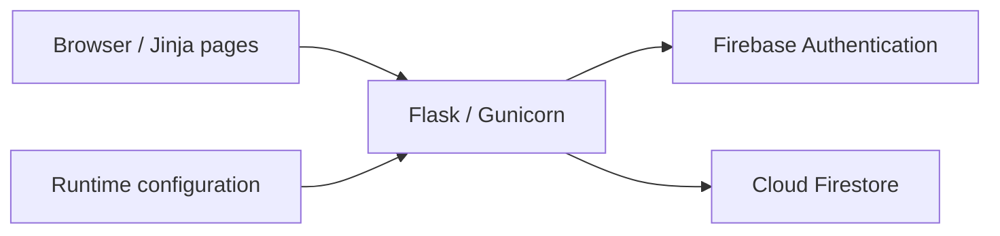

# Tip allocation and payroll summaries

A Flask application for recording client tips, splitting them between teammates, and reviewing totals by pay period. This is a recovered and updated version of an application I originally wrote for a small service business.

It retains the original Flask routes, Jinja templates, Firebase Authentication integration, and Firestore data access. Configuration is supplied at runtime, using a new Firebase project.

## Application workflow

1. Sign in with a Firebase email/password account.
2. Add teammates and create a pay period.
3. Record a client visit and allocate its tip across participating teammates.
4. Review the pay-period summary by teammate and visit date.

## Architecture



The browser submits forms to Flask. Firebase Authentication handles sign-in, and Flask keeps the signed-in user identifier in its signed session. Firestore stores teammates, pay periods, and tip records. The application uses Firebase Admin for database access.

## Run locally

Requirements: Docker Compose and a new Firebase project with Email/Password Authentication and Firestore enabled.

Follow [Firebase setup](RUN_WITH_NEW_FIREBASE.md) to create a test account and provide the new project configuration. Files under `secrets/` are examples, not working credentials.

```sh
docker compose up --build
```

Open [localhost:8080](http://localhost:8080). The supplied Compose file binds the app to the local computer. An unconfigured checkout intentionally fails instead of connecting to the historical project.

Use fictional teammates, clients, and tip records. No client database or employee records are included.

## Recovery changes

- Retained the original application workflow and Firebase integration.
- Moved configuration and credentials into runtime files or environment variables.
- Added example configuration files and ignored the real local files.
- Replaced the archived uWSGI/Nginx setup with Python 3.11 and Gunicorn.
- Removed session-data logging and excluded Firebase tokens from browser sessions.

## Source map

| Path | Purpose |
| --- | --- |
| `app/app/main.py` | Routes, form processing, and payroll summaries |
| `app/app/database_io.py` | Firestore reads and writes |
| `app/app/templates/` | Jinja pages and allocation form |
| `secrets/*.example.json` | Configuration structure without credentials |
| `Dockerfile`, `compose.yaml` | Local container setup |

## Current limitations

This historical application is a portfolio source sample. It requires new Firebase configuration and has not been verified against a newly provisioned Firebase project during this publication pass. Before accepting real users or payroll data, it needs CSRF protection, request validation, authorization review, rate limiting, and more automated coverage. See [security notes](SECURITY.md).

The recovery preserves legacy calculation and rounding behavior. Reported totals demonstrate the workflow and should not be used as a payroll accounting service.

## Validation

The container image builds successfully, and Flask, Pyrebase, Firebase Admin, and Gunicorn import successfully with networking disabled. Python syntax and credential-pattern checks also pass. These checks do not establish that a full Firebase-backed workflow passes; that requires an isolated test project and test accounts.

